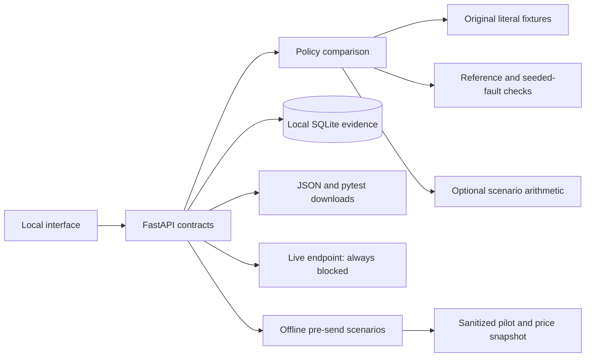

# CarbonTrace local architecture

## ADR-008: Published workload energy is separate from custom-prompt planning

**Status:** implemented on 2026-10-17; supersedes ADR-007's default landing view.
**Decision:** make the pinned CLEER workload comparison the default view. Use only
actual CSV records, exact names, and their standardized session definitions. Scale
published energy means with Decimal arithmetic; preserve per-session SD without
inventing aggregate confidence bounds. Calculate operational electricity emissions
under an explicit user grid scenario, applying no duplicate PUE. Package the
licensed dataset and attribution. Missing coverage remains null, including the
current 3.8 Flash pilot model. No runtime source refresh or provider call.
**Consequences:** a credible, traceable session comparison, not a request-level
energy estimator or quality-equivalence claim. Dataset/report versions and source
metadata inconsistencies are disclosed. Custom-prompt carbon illustrations are
now off by default. See [source audit](cleer-comparison.md).

## Requirements

One local unit-test generation policy demonstration; original code; real local
fault checks; honest synthetic usage; optional explicit energy scenarios; low
operational complexity; no live model calls or cloud spending without a bounded
cost estimate and explicit approval.

## ADR-001: One original Python application

**Status:** implemented for local v0.1; available for user review.
**Context:** the prototype needs a real evaluator and an inspectable interface.
**Decision:** FastAPI + Jinja + buildless original CSS/JS; independent package and
lockfile. Original implementation without copied source.
**Alternatives:** a separate React client adds a second build toolchain; a static
mock cannot provide actual local function checks or SQLite persistence.
**Consequences:** one environment and no frontend build; the interface is less
suited to a large application than a component framework.

## ADR-002: Evaluate literal fixture cases, not uploaded code

**Status:** implemented for the fixture web interface; a separate container CLI now handles candidate Python.
**Context:** generated Python would be untrusted executable input.
**Decision:** project-owned callables and validated exercise IDs only; no eval,
exec, arbitrary source upload, subprocess command, or model output execution.
**Alternatives:** running arbitrary pytest on the host is inappropriate;
container-isolated execution adds scope before a real model is connected.
**Consequences:** meaningful checks for curated exercises, but this version is
not a general-purpose Python test runner. Downloaded first-party suites are
verified in separate local test subprocesses.

## ADR-003: Separate unavailable estimates from hypothetical scenarios

**Status:** implemented; calibration remains open.
**Context:** no measured provider energy or defensible model coefficients exist
in our inputs. The user requested original implementation.
**Decision:** no calibrated provider carbon defaults. Independently implement
allocated power × time × facility overhead and electricity-intensity conversion
behind an explicit scenario option. At the user's request, the pre-send UI enables
editable demonstration assumptions by default; API requests must supply them.
Keep actual provider carbon null and scenario results separately labelled in
the response/export. Preserve ranges and provenance.
**Alternatives:** invented per-token/model factors produce unsupported claims;
copying an upstream estimator violates the requested project boundary.
**Consequences:** transparent arithmetic, but real Gemini carbon is unavailable.

## ADR-004: Local evidence storage and fail-closed model execution

**Status:** implemented locally; deployment and provider work deferred.
**Context:** costs need user approval and benchmark evidence needs inspection.
**Decision:** SQLite history and JSON exports; no provider SDK or model client.
The live endpoint returns HTTP 423 regardless of flags or request claims.
**Alternatives:** managed databases and active provider clients introduce
credentials, permissions, deployment, and billing work before the local flow is
validated.
**Consequences:** cheap and inspectable; SQLite must be replaced or externally
persisted for multi-instance cloud hosting. A future execution approval mechanism
must be server-side and bound to an exact priced plan.

## Failure handling

Invalid IDs/fields/scenario values are rejected. A compact quality failure
escalates and counts both attempts. Final quality failure suppresses an efficiency
recommendation. Missing calibration stays unavailable. Overlapping scenario
ranges do not force a direction. Storage errors propagate as errors rather than
claiming evidence was saved. Public hosting, authentication, and arbitrary-code
sandbox hosting are deliberately not implemented in this local version.

## ADR-005: Separate container execution and a frozen evaluation split

**Status:** implemented locally, with no provider client.
**Context:** real model output is executable input and three demos are too narrow
for an exploratory model comparison.
**Decision:** expand to 20 original functions / 80 defects, freeze a 14/6 split and
hash manifest, construct source-only prompts, and evaluate candidate Python only
through a rootless, restricted Podman CLI. Use one container per implementation;
never fall back to host Python. Keep holdout items out of UI tuning routes.
**Consequences:** local image/VM preparation is required; the runner cannot be used
as a public multi-tenant sandbox or adversarially secure grading service. Real
model behavior and provider energy remain unknown. See [protocol](benchmark-protocol.md)
and [execution boundary](sandbox.md).

## ADR-006: Human-approved one-shot Gemini experiment

**Status:** the approved six-response pilot is complete. All six suites met the
seeded-fault quality gate. A separately approved five-call continuation used the
explicit ProtoJSON zero-default policy and reused the saved first response;
see [results](pilot-comparison.md). All three plan ledgers are consumed.
**Decision:** keep the web app's fixture mode and blocked live endpoint. A separate
explicit CLI consumes a single recorded human approval for the exact hashed quote.
Use user ADC outside the repository, the global Standard PayGo endpoint, a pinned
SDK, and a persisted operation ledger. Disable SDK retries, function calling, and
automatic continuation. Preserve unknown billing outcomes and stop on uncertainty.
**Consequences:** a failed/interrupted run cannot automatically replay. The local
filesystem owner remains trusted; this receipt/ledger is not public multi-user
authorization. Provider energy stays uncalibrated. See [operation](live-smoke.md).

## ADR-007: Pre-send advisor with separate evidence levels

**Status:** implemented locally; see [advisor guide](pre-send-advisor.md).
**Decision:** make pre-send planning the default view. Accept prompt/context as
bounded text data without execution or persistence. Match the full visible-payload
hash to packaged original pilot observations; edited prompts lose that exact-match
claim. Use explicit generated-token scenarios and dated price arithmetic. Preserve
null provider carbon/energy until a defensible attribution profile exists.
**Consequences:** no network model call, credential access, or draft history entry
is needed for previews. Exports omit prompt text. This plans one visible request;
agent-wide auto-routing and VS Code model-picker integration remain future work.
