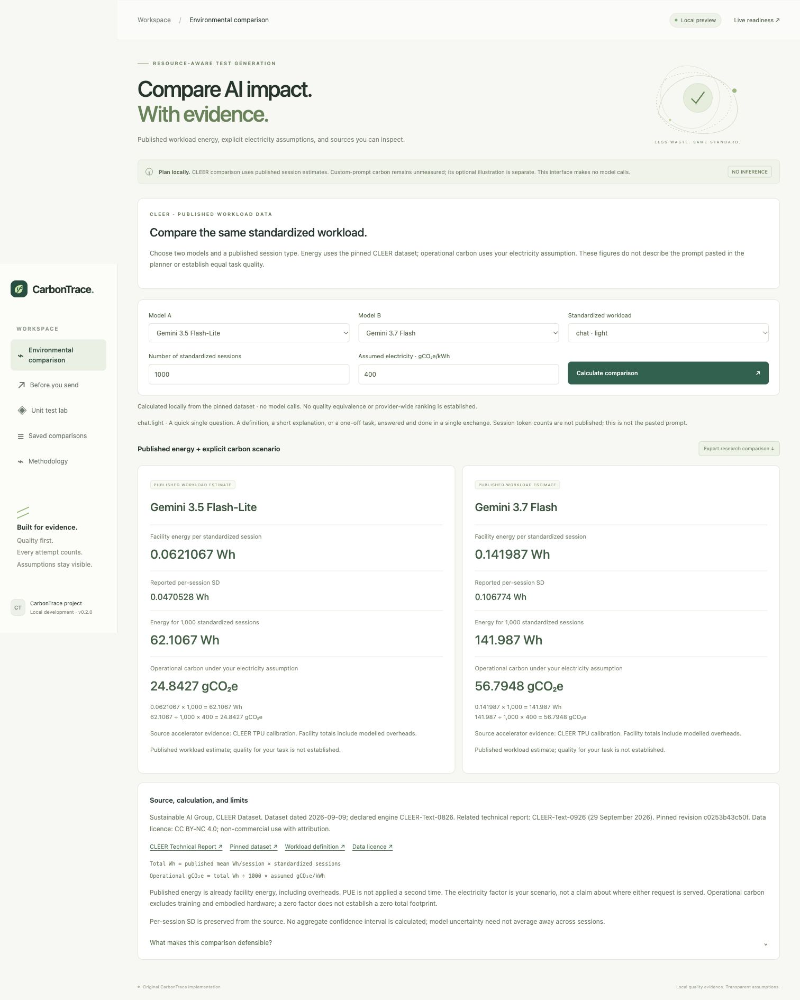

# Published environmental comparison



The default local view compares two exact model names under one CLEER standardized
workload. All 51 models and six workloads in the pinned CSV are available. There
is no conversion from a custom prompt, token estimate, or API price to these
session records. The prompt planner remains separate and its optional illustrative
carbon calculation is now disabled by default.

## Source and attribution

Sustainable AI Group, **CLEER Dataset**, schema v1.0.0, generated 2026-09-09,
declared energy engine CLEER-Text-0826 and accounting version
Closed-AI-Inference-Emissions-Methodology-0826.

- [Pinned data](https://github.com/sustainableaigroup/CLEER/blob/c0253b43c50f91e538fecdcd0355a99c62359b78/data/v1/cleer-dashboard-data.csv)
- [Schema and published-data limits](https://github.com/sustainableaigroup/CLEER/blob/c0253b43c50f91e538fecdcd0355a99c62359b78/data/v1/schema.md)
- [Original metadata](https://github.com/sustainableaigroup/CLEER/blob/c0253b43c50f91e538fecdcd0355a99c62359b78/data/v1/meta.json)
- [Related CLEER technical report](https://reports.sustainableaigroup.com/CLEER-Tech-Report/),
  CLEER-Text-0926, 29 September 2026. This is related methodology, not represented
  as the same version as the dataset engine.
- [Data licence](https://github.com/sustainableaigroup/CLEER/blob/c0253b43c50f91e538fecdcd0355a99c62359b78/data/LICENSE):
  CC BY-NC 4.0; appropriate credit, licence link, and modification notice are
  included. Commercial reuse requires separate written permission from SAIG.
  This integration is a local non-commercial hackathon prototype.

No upstream implementation is copied. The published CSV is redistributed under
its data licence, with CRLF normalized to LF. Its packaged SHA256 is
`fa698cdb9f43a54288888a915b4784ac354e990a85a5331ac9c861360b1c4ce8`.
The backend rejects a changed snapshot rather than silently retaining its citation.
The original licence is included in `resources/CLEER-DATA-LICENSE.txt`.

## Calculation

```text
total facility Wh = published mean Wh/session × number of standardized sessions
operational gCO₂e = total facility Wh / 1000 × assumed electricity gCO₂e/kWh
```

For 1,000 Chat/Light sessions with Gemini 3.5 Flash-Lite:

```text
0.062106712990 Wh/session × 1000 = 62.106712990 Wh
62.106712990 Wh / 1000 × 400 gCO₂e/kWh = 24.842685196 gCO₂e
```

The 400 gCO₂e/kWh factor is an editable scenario, not a measured serving-region
factor. Facility energy already contains overheads, so no extra host, idle, or
PUE multiplier is applied. Operational carbon excludes training, embodied
hardware, construction, networking, and end-user devices. A zero grid factor is
not a claim of zero lifecycle footprint.

Per-session SD is preserved as published, including null where not reported.
No statistical confidence interval or aggregate SD is invented. Model uncertainty
may be correlated across sessions; increasing volume does not make it disappear.
Equal workload does not imply equal quality for a coding task. There is no
automatic winner or provider-wide recommendation.

## Snapshot audit and limits

- The source schema explicitly withholds per-token energy intensities and the
  token recipes for its workloads. Session totals cannot be divided into a
  defensible arbitrary-prompt coefficient. Prompt text is not accepted by this API.
- Source metadata says 52 models, but the CSV contains 51 × 6 = 306 unique records.
  The UI offers the actual 51 and an explicit unsupported entry for Gemini 3.8
  Flash. Missing estimates remain null; Gemini 3.7 is never substituted for 3.8.
- The related technical report and declared dataset engine have different version
  identifiers. Both are visible in the UI and exports.
- Published carbon columns are not used. They include operational, embodied, and
  construction components, unlike our operational-only scenario. In this snapshot,
  for example, the Claude Fable 5 Chat/Light operational-carbon / facility-energy
  ratio is approximately 0.64 g/Wh, whereas metadata declares 730 g/kWh (0.73 g/Wh).
  This inconsistency is disclosed rather than propagated into an attributed
  request-level carbon estimate. Energy numbers are preserved as published.
- Source cost fields and capability indices are not used. The research view does
  not claim current pricing or independently measured model quality.

## Local boundary and exports

`GET /api/research/catalog` exposes attribution and exact available names/workloads.
`POST /api/research/compare` accepts two different registered names, one workload,
1–1,000,000 integer sessions, and an electricity factor in 0–2000 gCO₂e/kWh.
It performs local Decimal arithmetic only, creates no provider client, stores no
run, and calls no external service. Draft/prompt/approval fields are rejected.

JSON export includes the request, original per-session energy/SD, totals, explicit
operational carbon basis, null coverage where needed, source URLs, commit, licence,
modification notice, limitations, and snapshot hash. Changing an input clears the
old results and disables export until recalculation succeeds.
