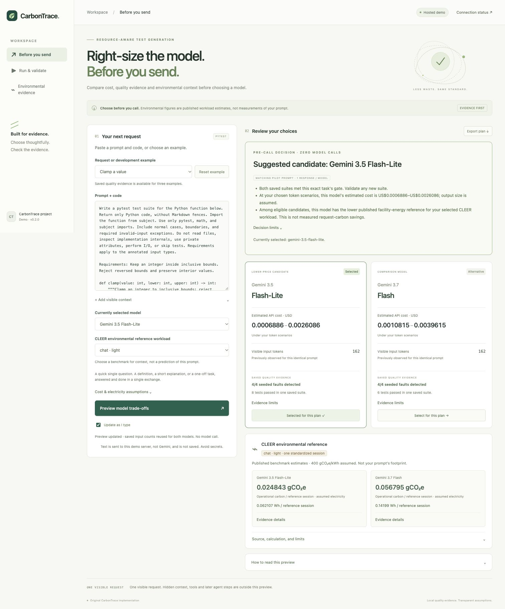

# Cloud Run demo deployment

The current hosted integration is verified in [hosted-live.md](hosted-live.md).
It adds the approved six-run shared Gemini pool. The initial preview deployment
record below is retained as historical evidence.

Initial preview status: deployed and verified. [Open the public demo](https://carbontrace-demo-683634661093.us-central1.run.app).

One build and one revision completed. [Deployment receipt](cloud-run-result.json),
[public HTTP checks](cloud-run-smoke.json), and [user approval](cloud-run-approval.json)
record the outcome. The plan below records the approved configuration and estimate.
New Gemini requests remain disabled; no inference calls were made.

The public service supports custom prompt planning, published environmental
comparisons, and the packaged recorded Gemini results. It does not save visitors'
prompts, expose local run records, generate model output, or execute Python.
Text entered in the planner is processed by the demo server, not Gemini.

## Prepared configuration

| Setting | Planned value |
| --- | --- |
| Project | `carbontrace-511814` |
| Region | `us-central1` |
| Service | `carbontrace-demo` |
| Access | Public HTTPS; repository visibility unchanged |
| CPU / memory | 1 vCPU / 512 MiB |
| Billing | Request-based, CPU throttling enabled |
| Scaling | Minimum 0, maximum 1 instance; concurrency 16 |
| Request timeout | 15 seconds |
| Mode | `CARBONTRACE_MODE=hosted-preview` |
| Database / Vertex permissions | None |
| Runtime identity | `carbontrace-web@carbontrace-511814.iam.gserviceaccount.com`, no project roles |
| Build | One E2_MEDIUM build, timeout 600 seconds, no automatic retry |

The container listens on `0.0.0.0:$PORT`, runs as a non-root user, and installs
hash-locked dependencies exported from `uv.lock`. Upload and container allowlists
exclude local tools, credentials, environment files, run data, Git, tests and docs.
The preview never initializes SQLite or uses container files for durable records.

## Cost estimate, checked 18 October 2026

Planning scenario: one build of at most ten minutes; at most 3,600 billed vCPU
seconds at 512 MiB; 10,000 HTTP requests; one image up to 1 GiB-month; low traffic
and logging. Before free tiers, tax, currency conversion, credits or discounts:

- E2_MEDIUM build: 10 × USD 0.003 = USD 0.030.
- Cloud Run active CPU: 3,600 × USD 0.000024 = USD 0.0864.
- Cloud Run active RAM: 3,600 × 0.5 × USD 0.0000025 = USD 0.0045.
- Requests: 10,000 / 1,000,000 × USD 0.40 = USD 0.004.
- Image storage: approximately USD 0.10 per full GiB-month without free storage.

Subtotal approximately USD 0.225. Allow USD 0.25–1 for a light first-week demo,
including small source-storage, logging and transfer charges. Actual charges
depend on traffic, build duration, image size, retention and shared account quotas.
Proposed allowance: USD 1 before tax/FX; this is not a hard Google billing cap.
Maximum instances limits scaling, not total spending. Keeping zero minimum
instances avoids a warm-idle allocation. No inference calls are part of this plan.

Sources: [Cloud Run pricing](https://cloud.google.com/run/pricing),
[Cloud Build pricing](https://cloud.google.com/build/pricing),
[Artifact Registry pricing](https://cloud.google.com/artifact-registry/pricing),
[container contract](https://docs.cloud.google.com/run/docs/container-contract).

## Deployment sequence after explicit approval

1. Enable Cloud Run, Cloud Build, Artifact Registry, IAM, Resource Manager and
   Cloud Billing APIs. Recheck billing; stop if disabled or permissions are missing.
2. Create one regional Docker repository `carbontrace` and one private regional
   source bucket `carbontrace-511814-build-source` if absent.
3. Create two dedicated service accounts if absent. The runtime account gets no
   project roles. Give the build account repository-scoped Artifact Registry Writer,
   bucket-scoped Storage Object Viewer, and project Logs Writer. Check the existing
   deployer's service-account usage permission; do not grant Owner/Editor.
4. Submit the frozen source snapshot to Cloud Build using the build identity:

   ```sh
   gcloud builds submit <prepared-source-directory> \
     --project=carbontrace-511814 --region=us-central1 \
     --config=<prepared-source-directory>/cloudbuild.yaml \
     --service-account=projects/carbontrace-511814/serviceAccounts/carbontrace-build@carbontrace-511814.iam.gserviceaccount.com \
     --gcs-source-staging-dir=gs://carbontrace-511814-build-source/source \
     --substitutions=_IMAGE=us-central1-docker.pkg.dev/carbontrace-511814/carbontrace/web:<source-hash>
   ```

5. Resolve the pushed image digest and deploy that immutable image:

   ```sh
   gcloud run deploy carbontrace-demo \
     --project=carbontrace-511814 --region=us-central1 \
     --image=us-central1-docker.pkg.dev/carbontrace-511814/carbontrace/web@sha256:<image-digest> \
     --service-account=carbontrace-web@carbontrace-511814.iam.gserviceaccount.com \
     --set-env-vars=CARBONTRACE_MODE=hosted-preview \
     --port=8080 --cpu=1 --memory=512Mi \
     --min=0 --max=1 --concurrency=16 --timeout=15s \
     --cpu-throttling --no-cpu-boost --allow-unauthenticated
   ```

6. Verify the public URL: custom previews, recorded results, source links and
   export. Verify local preparation/private records and live execution stay blocked.
   No fresh Gemini request is needed for this verification.

Missing permissions or build failure stops this attempt. No automatic builds,
continuous deployment, scheduled jobs, paid scanners, database or GPU are planned.
Retain existing IAM/resources; do not overwrite or delete unrelated resources.

## After hosting

Record a short walkthrough, add the deployed URL and architecture to the submission
materials, and review the event's final submission checklist. Repository publication
is a separate user decision; it currently remains private. Further evidence quality
or fresh hosted Gemini execution is a later task, not implied by this deployment.

Prepared source fingerprint: 020220bb664bc13b58c18183e41ce4f349c558f43da07ab796bf12e59a1dc3cd.
[Exact deployment plan](cloud-run-plan.json), [recorded approval](cloud-run-approval.json).


