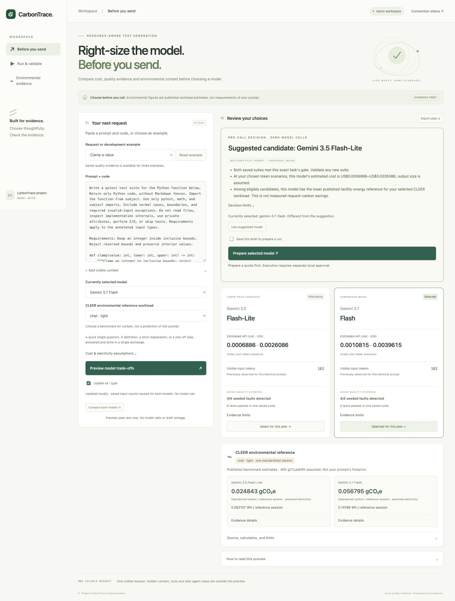

# CarbonTrace demo

[Public Cloud Run demo](https://carbontrace-demo-683634661093.us-central1.run.app).
The public app supports planning, recorded evidence and a small shared Gemini pool.

1. Open **Before you send**. Keep Clamp selected and choose the `chat.light`
   benchmark. Explain the saved quality evidence, assumed output size and cost
   range. CLEER supplies environmental context, not this prompt's actual footprint.
2. Use the suggested model. Editing the prompt removes the exact quality match;
   the app then asks for a manual choice instead of promising equivalent quality.
3. Click **Review selected model run**. Review the exact text and cost, then approve
   one generation if shared capacity remains. Inspect real usage and returned text.
   Fresh output has not been quality checked. Preparing the quote makes no model call.
4. Open **Run & validate** to inspect the bundled recorded comparison. It shows actual responses,
   tokens, catalog cost and correct-function / four-fault checks. Its label makes
   clear that viewing it makes no new calls. Expand the returned tests if useful.
5. Open **Environmental evidence** only to explain the source or calculation.
   Source, licence and uncertainty details stay available in disclosures.
   The hypothetical hardware calculator is excluded from the demo interface.

Six reservations are shared by everyone, including two completed verification
runs. Four remained on 18 October 2026. The pool expires 25 October at 23:59 UTC.
The planner and recorded comparison continue to work afterward.

For the separate local workflow, from the project root with the virtual environment
active, run:

```sh
python -m carbontrace.live_compare_cli --id <run-id>
```

Use `--directory <configured-store>` if the server uses a custom store. Read the
exact plan and price, then approve its full hash in that terminal. Quoting does
not authorize execution. The recorded demo is read-only and cannot be replayed.

The packaged snapshot retains the original quote and results unchanged; only its
outer view removes local approval and slot fields. It contains reviewed toy code,
no credentials or personal filesystem paths. It remains separate from fresh output.


