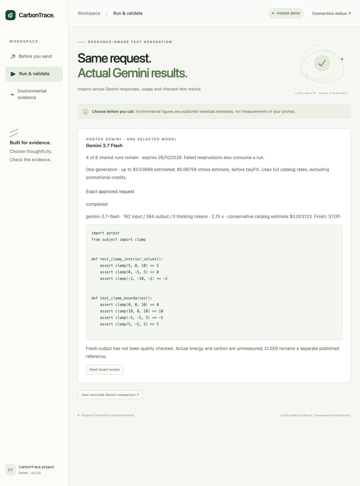

# Hosted Gemini integration

Deployed and verified on 18 October 2026. Revision `carbontrace-demo-00005-l9k`
provides one-click, sponsor-funded selected or paired Gemini runs. The original six-run limit has been
replaced by a durable **USD 4 model allowance**, including prior usage. Three prior
reservations were preserved; after the approved two-model shipping-fee verification,
**USD 3.753830 remained**. Both responses completed with raw usage preserved.
Live runs expire 6 November 2026 at 11:59 PM IST (18:29 UTC), or earlier when the
remaining allowance cannot fund the selected request.

[Current paired update and checks](hosted-comparison-update.md),
[deployment receipt](hosted-comparison-result.json),
[raw paired responses](hosted-comparison-live-results.json), and
[priced approval](hosted-comparison-approval.json).

## Earlier integration evidence

[Deployment receipt](hosted-deployment-result.json),
[real responses and usage](hosted-live-results.json),
[HTTP checks](hosted-http-smoke.json), and
[user approval](hosted-deployment-approval.json).

The earlier [expiry-extension receipt](judging-extension-result.json) records
the date-only update before the dollar-budget migration.

The two fresh responses used 162 input tokens each and 359 / 384 output tokens.
Their combined conservative catalog estimate was USD 0.0040691. This is not the
invoice. Fresh output was not executed or quality evaluated.

## One complete decision

Preview an example without model calls → inspect historical quality and separate
CLEER context → choose one model → inspect the sponsor reservation → click
**Run Gemini** once → inspect actual usage and returned text.

For a direct experiment, **Compare Flash-Lite + Flash** reserves both requests
atomically and returns their outputs side by side. One pair reserves USD 0.089293.
The comparison identifies lower observed catalog cost, with no automatic quality
winner or measured carbon-saving claim. Saved links make no new inference calls.

Fresh code is never executed on Cloud Run. Saved mutation-test results describe
the saved suites, not a new response. Actual per-request energy/carbon stay null.

## Shared allowance

USD 4 in model reservations is shared by everyone, including earlier runs.
The fixed epoch is `carbontrace-public-demo-20261018-v1`; it is not regenerated
on startup, redeployment or receipt expiry. A single private Cloud Storage object
uses generation-match compare-and-swap to reserve capacity before provider-client
creation. Duplicate request IDs return the previous receipt without dispatch.
The operator initializes the meter once; a missing meter stops execution rather
than creating a new allowance.
Reservations use the full-rate stress scenario, rounded upward to microdollars:
USD 0.021709 for Flash-Lite and USD 0.067584 for Flash. All reservations are retained
without refunds, including failures. This is reserved allowance, not actual billed
spend. Storage failure stops execution. Quotes expire in ten minutes; the shared
budget stops accepting fresh runs at the fixed deployment expiry.

Clicking Run approves the exact signed request and disclosed reservation, without
a separate allowance checkbox or approval page. Preview never sends a model call. Requests
use only Gemini 3.5 Flash-Lite or 3.7 Flash, global Standard PayGo, one candidate,
LOW thinking, 4,096 input tokens and a requested 4,096 output tokens. One count
operation precedes one generation; no metadata, tools, grounding, fallback, paid
grading or automatic retries are used. These controls are not a billing cap.

Each response preserves raw usage alongside documented optional-zero defaults.
Cost uses conservative full catalog rates: Lite USD 0.30/2.50 and Flash 1.50/7.50
per million input/generated tokens. Flash's current introductory rates may make
the invoice lower. Catalog estimates exclude tax, FX and credits.

## Cloud configuration and estimate

The public service is in `carbontrace-511814`, `us-central1`. This update used one build
with a ten-minute timeout, one revision, 1 vCPU / 512 MiB, min 0 / max 1 instance,
concurrency 16 and a 180-second request timeout. Existing build/source resources
remain private. The existing private ledger bucket, signing secret, APIs and IAM
were reused. No database or API keys.

Runtime permissions: project custom role containing `aiplatform.endpoints.predict`,
`roles/storage.objectUser` on the ledger bucket, and `roles/secretmanager.secretAccessor`
on the signing secret. The build identity retains its existing limited permissions.
Only the Cloud Run web service is public. Runtime settings were verified unchanged.

Approved overall allowance: **USD 5**, before tax/FX, not a hard billing cap.
USD 4 covers model reservations including prior usage; USD 1 covers the update and
light hosting (estimate USD 0.25–1.00). The latest image update was followed by the
approved pair: two agent generations and two token counts, with zero retries.
Per-model reservations use 4,096 input and 8,192 generated
tokens; actual generation still requests at most 4,096 output tokens. Introductory
credits and shared free tiers are not assumed in these conservative estimates.
Traffic and retained infrastructure can continue to incur charges after the
generation pool expires; maximum instances does not cap total web spending.

Approved prompts and responses stay in a bucket with public access prevention and
uniform IAM. A lifecycle rule schedules only `runs/` for deletion after seven days;
the budget object is retained. Receipt IDs are unguessable capabilities; anyone
holding an ID can retrieve that receipt. Do not put sensitive material in the demo.

Sources checked 18 October 2026:
[model pricing](https://cloud.google.com/gemini-enterprise-agent-platform/generative-ai/pricing),
[Secret Manager pricing](https://cloud.google.com/secret-manager/pricing),
[Cloud Run pricing](https://cloud.google.com/run/pricing),
[storage preconditions](https://docs.cloud.google.com/storage/docs/request-preconditions).
