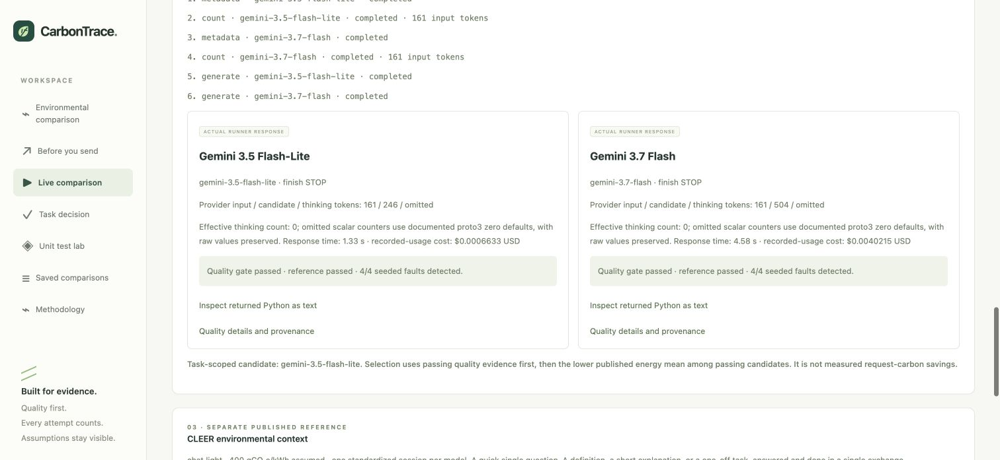

# First completed browser-prepared Gemini comparison

The user manually executed the exact approved Clamp plan on 17 October 2026,
starting at 23:49:07 IST. Two metadata reads, two token counts and two generations
completed with zero retries. Both response model versions match their requested
IDs and both finished with `STOP`.

| Observation | Gemini 3.5 Flash-Lite | Gemini 3.7 Flash |
| --- | ---: | ---: |
| Google-counted / reported input tokens | 161 | 161 |
| Reported candidate tokens | 246 | 504 |
| Reference tests passed | 7 | 6 |
| Seeded faults detected | 4 / 4 | 4 / 4 |
| API response time | 1.33 s | 4.58 s |
| Recorded-usage catalog cost, USD | 0.0006633 | 0.0040215 |

**Combined catalog cost: USD 0.0046848**, before credits/tax/FX, below the approved
USD 0.10 allowance. This is arithmetic from provider-reported usage at the quoted
rates, not a verified invoice. Flash rates exclude promotional credits. Raw omitted
thinking/cache/tool counters remain null; effective zero values use the approved
`protojson_full_v3` policy. Primary input/candidate/total counters reconcile.

Both suites passed the same strict quality gate in the pinned rootless runner:
nonempty clean reference tests, all four seeded faults detected, unchanged test
counts, no test errors or skips. The returned suite hashes match their evaluated
quality reports. Model output was never executed on the host.

The selected task-scoped candidate is **Gemini 3.5 Flash-Lite**: it passed the gate
and has the lower published CLEER mean for `chat.light`. The cost and latency
observations also favour its returned response in this run. A single response per
model/function does not establish general quality equivalence or future speed.
Request energy/carbon remain unmeasured; CLEER is a separate session benchmark.

Chrome verified the completed operation states, both real returned Python suites,
quality outcomes and recommendation. The downloaded JSON export exactly matches
the saved request, actual outputs and local result record. Reading it sends no new
provider requests. Two unused local demo slots do not authorize additional calls.

Plan SHA256: `317e3391ea97c87e11a4192974abf5ee76e33fe687ec08b2d67306bfc9eb686a`.
Prompt SHA256: `c4974a30db1a0b96b8a971fb0add322183be8257e514239afa89631f4d1d44f8`.
The [sanitized report](live-comparison-results.json) preserves operation counts,
usage, quality reports, suite hashes and the raw local result-file fingerprint.
Full request/output text and the explicit human approval receipt remain under
ignored local `data/live-comparisons/`.

