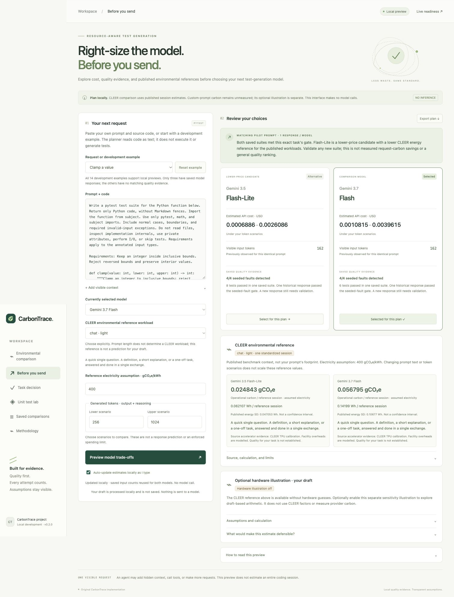

# Before you send

The **Before you send** tab is an offline pre-send advisor for a single visible
test-generation request. It compares Gemini 3.5 Flash-Lite and Gemini 3.7 Flash.
The existing fixture lab and saved fixture comparisons remain available separately.

This is now the default screen, with a prominent evidence-scoped decision card and
an option to prepare execution for only the chosen model. See the current
[pre-call demonstration and single-model execution guide](precall-decision.md).
Planning does not save the draft; preparing an execution quote saves it only after
explicit local-storage consent and still makes no provider calls.



## Try the workflow

Start the local app from the project directory:

```sh
.venv/bin/uvicorn carbontrace.app:create_app --factory --host 127.0.0.1 --port 8765
```

Open http://127.0.0.1:8765/ and select **Before you send**.

For your own function, choose **Custom prompt + code** and paste the instruction
and source together. Optional context is counted too. With **Auto-update estimates
locally as I type** enabled, the preview refreshes 600 ms after your last edit.
You can turn it off and use the Preview button. All requests stay on the local
CarbonTrace server; this is not streamed provider telemetry or a token-count API.
Custom code is treated as text and is not executed or graded. Quality remains
unestablished for unseen prompts. Cost uses the dated price snapshot.

Choose a **CLEER environmental reference workload** explicitly and set its
electricity assumption (default 400 gCO₂e/kWh). The reference panel uses the same
pinned dataset as the [published comparison](cleer-comparison.md), with source
links, original per-session energy/SD, licence, revision, and limitations. It uses
one standardized session, regardless of prompt length or generated-token scenarios.
Both models have exact source records and three fresh evaluated responses from
the approved paired experiment. Original Gemini 3.8 responses remain preserved
separately; they were never relabelled as 3.7 evidence. No default workload is inferred for your draft.

Reference operational carbon is `published facility Wh/session / 1000 * assumed
gCO₂e/kWh`. There is no additional PUE. The electricity factor is an assumption,
not the actual serving-region factor; embodied hardware and training are excluded.
Reported SD is not a calibrated confidence interval. The benchmark does not
establish task quality or predict your custom prompt's footprint.

The separate **Optional hardware illustration** remains off by default. When
enabled, its table and worked example show assumed timing, watts, PUE and grid.
These hardware inputs do not affect the CLEER reference. Edits invalidate old
results and exports until recalculation succeeds. Model emissions remain
unmeasured even when the local preview updates.

1. Load **Clamp a value**. The prompt exactly matches a saved pilot request, so
   both models show their previously observed input counts and one saved quality
   result each. Both passed the reference and four seeded-fault checks. This is past evidence, not a prediction that another suite will pass.
2. Choose lower and upper **output plus reasoning** token scenarios. The preview
   combines those assumptions with each model's dated catalog rates.
3. Select a model for the plan. This updates the plan only; it changes no IDE or
   provider settings and sends no generation request.
4. Edit the prompt or add context. The old preview is invalidated immediately.
   Refreshing removes the exact-match evidence badge and uses rough local token
   planning scenarios. The original pilot remains clearly labelled as historical.
5. Export the plan as JSON. It contains scenarios, evidence metadata, and a SHA256
   prompt fingerprint; it excludes prompt and context text. Drafts are not stored
   in the app's SQLite comparison history.

The export includes `research_reference` when a workload is selected. It contains
the original evidence, operational-carbon arithmetic, source hash, attribution,
licence and modifications. The request accepts only `workload` and
`grid_g_per_kwh` inside `research_reference`; session count is fixed to one and
the exact model names cannot be overridden. Without selection the field is null;
actual prompt-level `carbon.energy_wh` and `carbon.carbon_g` stay null in all cases.

There is no send-to-model action. Web live execution remains HTTP 423, and a
downloaded plan cannot authorize inference. Auto-routing and integration into
another VS Code agent's model picker are future work.

## Estimate boundaries

All 14 development examples support previews and automatically load when selected.
Only three have exact saved pilot evidence. The other eleven show local planning
scenarios with quality explicitly unestablished. Six holdout functions remain
reserved for final evaluation. If the local server stops, the page offers a
Reconnect action; start the VS Code task **CarbonTrace: start local app** first.
Reconnecting keeps the current draft. It does not start any provider requests.

- **Input:** an identical full payload can reuse the count observed for its pilot
  model. Other drafts use 2–6 UTF-8 bytes per token as planning scenarios. Actual
  tokenization can fall outside that range; it is not a tokenizer or hard bound.
- **Generated tokens:** explicitly chosen output-plus-reasoning scenarios, not a
  response-length forecast, output cap, or spending limit.
- **Cost:** `(input tokens × input rate + generated tokens × generated rate) / 1e6`.
  Rates were checked on **2026-10-17** for global standard pay-as-you-go text: input/output per million tokens are $0.30/$2.50 for Flash-Lite and $0.75/$3.75 for 3.7 Flash. The latter are published introductory rates through 2026-12-31. Credits, taxes, FX, cache, batch/flex and regional premiums are excluded.
  They are conditional catalog estimates, not a verified current billing quote.
- **Quality:** six fresh saved responses, one per current model/function, across
  three development functions. Each passed its reference and four seeded faults.
  The original 3.8 Flash results remain in the original pilot report only. No probability of success or
  general model ranking is inferred from three examples.
- **Scope:** one visible request. Hidden system instructions, context added by an
  agent, later tool calls, retries and local quality-gate overhead are excluded.

## Illustrative carbon scenario

The demonstration scenario is now opt-in and disabled by default, following the
addition of the separate [published CLEER comparison](cleer-comparison.md).
The API requires an explicit `carbon_scenario` object. All scenario numbers and
exports say **illustrative**, and the separate actual-provider carbon fields
remain null. No per-model energy profile has been calibrated.

Default assumptions, all editable:

| Input | Demonstration value |
|---|---|
| Allocated power for the Flash-Lite scenario | 30–60 W |
| Allocated power for the Flash scenario | 120–180 W |
| Input processing speed, both scenarios | 1,000 tokens/s |
| Generated output + reasoning speed, both scenarios | 50 tokens/s |
| Facility PUE | 1.2 |
| Electricity emissions factor | 400 gCO₂e/kWh |

These are rounded exploration inputs, not measured Gemini specifications or
published regional emissions factors. Equal power assumptions produce equal
impacts for identical token counts regardless of model name. Different power
assumptions create the apparent model difference; the UI makes no carbon-savings
recommendation. Model quality and price evidence are unchanged.

The calculation uses:

```text
seconds = input tokens / input tokens per second
        + generated tokens / generated tokens per second
Wh = allocated W * seconds / 3600 * PUE
gCO₂e = Wh / 1000 * electricity factor
```

Allocated watts represent the request share of compute, memory, CPU, and idle
power, before facility overhead. Lower endpoints combine lower input/generated
token scenarios and lower allocated power; upper endpoints combine their upper
values. These are sensitivity scenarios, not statistical confidence intervals.
The linear timing assumption is not a latency forecast. Training, manufacture,
networking, user devices, later requests, and retries are excluded.

For the identical clamp prompt and default generated scenarios (256–1024), the
assumed duration is 5.282–20.642 seconds. The Flash-Lite scenario yields
0.05282–0.41284 Wh and 0.021128–0.165136 gCO₂e. The 3.7 Flash illustration uses the same previously observed 162 input tokens,
yielding 0.21128–1.23852 Wh and 0.084512–0.495408 gCO₂e. These ranges overlap and do not
prove a real carbon ranking.

### What would make this defensible?

The site retains this expandable section and explicitly explains that the current
numbers are assumptions. Replace them with scoped, dated energy measurements or
a validated energy model for the exact model/version/deployment. Account for
batching, resource sharing, idle power, CPU, and memory; identify the serving
region/time and electricity-accounting method; apply facility overhead only if it
is absent from the measured energy; and validate on representative workloads.
Publish uncertainty and include every attempted call in workflow totals. Broader
lifecycle claims require additional training/manufacture/network accounting.

[Google’s published measurement approach](https://cloud.google.com/blog/products/infrastructure/measuring-the-environmental-impact-of-ai-inference/)
is methodology context. Its Gemini Apps aggregate is not a calibration for our
specific API models; none of the scenario inputs are attributed to that study.


## Implementation and checks

`POST /api/preflight` computes scenarios without a provider dependency, credentials,
code execution, or draft persistence. `GET /api/preflight/examples` exposes only
the 14 development prompts. Sanitized pilot observations and price snapshots are
packaged for the current pair in `resources/preflight-comparison.json`, including
the original source report hash. `resources/preflight-evidence.json` preserves the
original 3.5/3.8 pilot snapshot unchanged.

253 offline tests pass with 97.88% backend statement coverage. Strict mypy, Black,
Ruff and JavaScript syntax checks pass. Chrome checks verified exact/custom prompt
states, plan-only model switching, stale-result invalidation, rejected inverted
ranges, actual JSON download without draft text, and the unchanged fixture flow.
At a 390-pixel viewport the advisor has no horizontal overflow. Software checks make no provider calls. The separately approved paired trial
sent six generations and is recorded in decision-trial-results.md. Keep the local server running while exploring; use the command above or the
VS Code task to restart it if needed.
