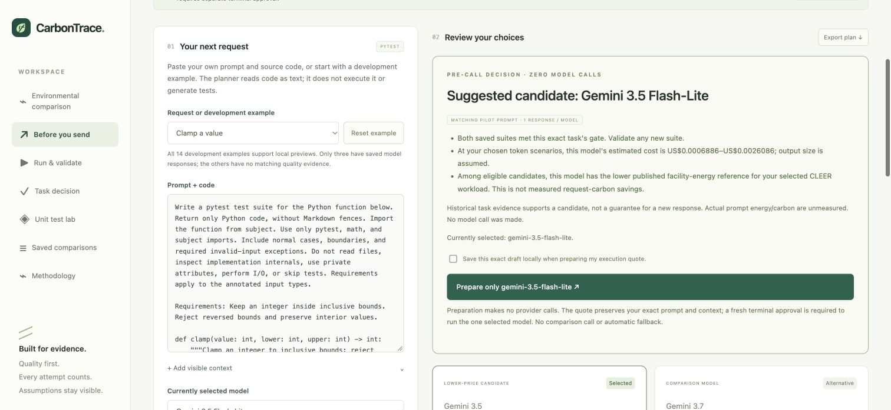
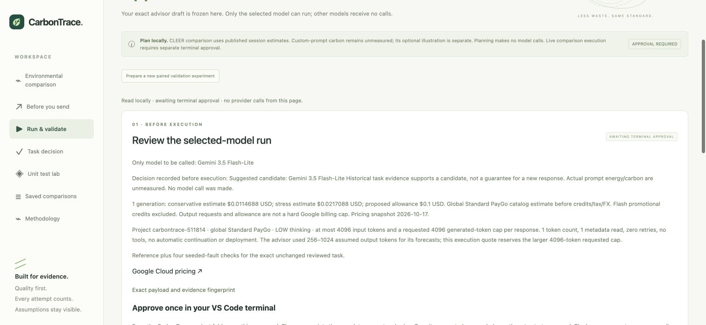

# Choose before sending

**Before you send is the default screen.** The main demonstration is one pre-call
decision, with past Gemini experiments supplying quality evidence. Paired live
comparison remains optional validation, not a required step for every request.

## Demonstrate one decision

1. Start with the unchanged Clamp example and select `chat.light` explicitly as a
   separate CLEER reference. The preview makes no model calls and saves no draft.
2. Review the suggested candidate, its exact-prompt historical quality scope,
   current token/cost scenarios and selected published environmental reference.
   The default model selection is explicit; the advisor does not change it for you.
3. Click **Use suggested model** if you accept it. Or choose another model manually.
   Editing the prompt/context removes matching quality evidence and therefore the
   comparative suggestion. Unknown quality is not treated as a failed model or as
   evidence that the larger model is necessary.
4. Confirm local storage and **Prepare only [selected model]**. The resulting quote
   contains exactly the reviewed prompt plus visible context, with no rewritten
   instructions, added system prompt or hidden model-generated routing call.
5. Inspect that one-model quote. It allows one generation, one token count and
   one metadata read, zero retries, no fallback, no tools and no deployment.
   The terminal owner must approve its exact hash before any provider operation.
   Preparing, exporting or opening the quote sends no model calls.
6. After an approved run, inspect the chosen model's actual response and usage.
   That response does not establish comparative quality for the uncalled model.
   Exact unchanged reviewed examples can be checked in the pinned rootless runner;
   arbitrary custom drafts have no trusted quality contract and are never executed.

## Recommendation boundary

Both exact models must have a saved observation for the identical complete payload.
A candidate must have passed its saved gate, with nonempty tests and all recorded
seeded faults detected. If both qualify, use the lower published facility-energy
mean for the explicitly selected CLEER workload. Without that reference, select
the lower upper cost scenario among passing candidates, then lower lower cost for
ties. A failing candidate cannot win on price or energy. If neither passes, suggest
neither; if either observation is missing, show insufficient comparative evidence.
There is no similarity classifier or quality transfer to edited prompts.

The recommendation is a task-scoped candidate from a small development pilot, not
a general quality ranking, a guarantee for a new response, or measured request
carbon savings. Actual prompt carbon remains unavailable. Changing input tokens
or output scenarios does not rescale CLEER session energy.

## Single-model plans

`POST /api/selected-runs/prepare` accepts the same validated `PreflightRequest` as
the advisor. The selected role maps to one exact registered Gemini model. Only the
visible payload is sent; token assumptions, grid and illustrative hardware values
are planning metadata, not hidden provider instructions. The quote uses explicit
conservative execution reserves at the existing 4096 input/output limits. This
can exceed the advisor's narrower assumed output range; both are labelled.

Schema version 2 stores its pre-call decision, exact payload and the one selected
model under the plan hash. Existing two-model plans retain their exact original
schema, hash and results. Shared read/export routes work for both. The separate
CLI dispatches only the plan's model rows and uses the selected model's own rates.
The web live endpoint remains blocked, and three local run slots are shared with
paired experiments. Preparing a plan neither reserves a slot nor approves spending.

Validation: 313 Python tests pass, 98.19% statement coverage; strict mypy, Black,
Ruff, JavaScript syntax and six client tests pass. Synthetic provider tests prove
one metadata/count/generation sequence for either selected model, exact context
preservation, correct model-specific cost arithmetic, no call to the alternative,
and no post-hoc paired recommendation. The completed legacy comparison hash is
unchanged. Chrome verified the supported suggestion, unknown-draft state, manual
choice, one-model quote and actual JSON export. No new live calls were made for
this refinement; the new single-model path is validated offline, while the earlier
paired run supplies the separately recorded live integration evidence.
