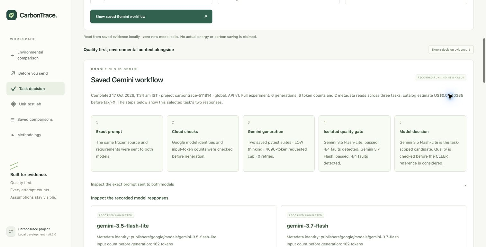
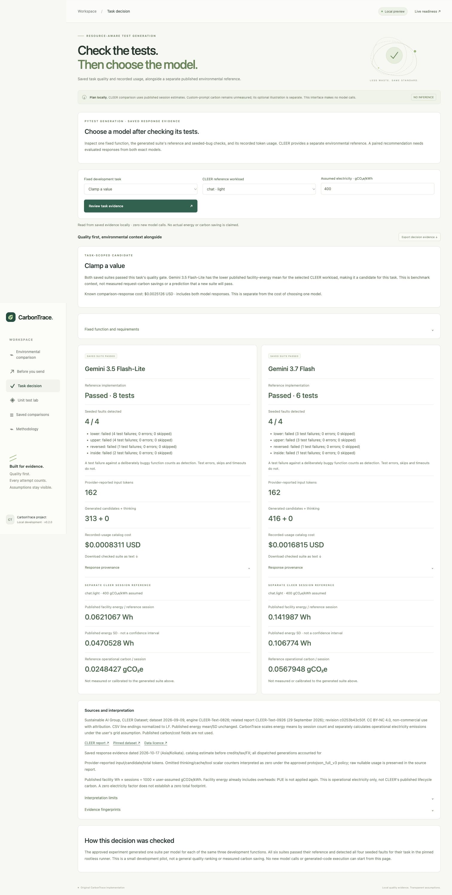

# Task-scoped model decision

Open **Task decision**, choose Clamp, Discount, or Merge intervals, and explicitly
select a CLEER reference workload. The app combines saved task checks and recorded
usage with a separate published environmental reference. It makes no new model
calls and executes no code.

Click **Show saved Gemini workflow** to inspect the completed cloud operations,
exact original prompt, generation settings and quality-first model decision.
**View saved generated tests** opens either checked suite inline as inert text.
The workflow is a recorded run, not live browser execution or simulated progress.
Its packaged trace is hash checked and tied to the same report, prompt and model
identities as the decision evidence. New browser requests do not grant approval
for further inference or generated-code execution.

## Current result

The approved 2026-10-17 experiment generated one fresh suite per model/function:
Gemini 3.5 Flash-Lite and Gemini 3.7 Flash across three owned development functions.
**All six passed their reference and detected all four seeded faults for their
task.** [Results and limits](decision-trial-results.md),
[structured report](decision-trial-results.json).

Both models therefore meet the saved gate for each example. Flash-Lite has the
lower CLEER facility-energy mean for the selected published workloads, so it is a
task-scoped candidate. This does not establish general quality equivalence,
predict a new response's quality, or measure carbon savings for these requests.

The six generations cost **USD 0.01010385** at the reviewed catalog rates before
credits, tax and FX. That is the complete comparison experiment, including both
models, rather than only the cost of selecting Flash-Lite. It is not a verified
Google invoice. The source ledger and original 3.5/3.8 pilot remain unchanged.

## Decision rule

1. Both exact models must have a saved response to the identical owned task prompt.
2. A reference pass requires nonempty tests, no failed tests, no errors and no skips.
3. Every seeded fault must trigger a test failure, without errors or skips.
   Timeouts and inconclusive results do not count as bug detection.
4. If both pass, prefer the lower published facility-energy mean under the selected
   CLEER workload. The choice describes these saved suites and that reference.
5. If only one passes, select the passing candidate regardless of the other's
   energy reference. If neither passes, recommend neither. Missing evidence blocks
   the paired decision instead of being counted as failure.

CLEER uses one standardized session. Request tokens do not scale its energy;
reported SD is not a confidence interval. Operational carbon uses an editable
electricity assumption and excludes grading, training, embodied hardware and other
workflow overheads. Sources, dataset/report versions, licence and scope are visible
and included in the export.

## Inspect and reproduce

Every model card shows reference-test outcome, individual seeded-fault checks,
provider-reported input/candidate tokens, interpreted thinking counters, recorded-
usage cost, exact response model version, suite hash and pinned runner image.
**Download checked suite as text** returns the exact evaluated bytes, with hash
verification. Reading/downloading never executes that code.

The structured source report preserves raw nullable usage and the explicit
approved `protojson_full_v3` interpretations. The sanitized packaged evidence has
its own SHA256, plus the source report hash and benchmark hash. API output and JSON
exports retain these fingerprints. Fresh observations also populate **Before you
send** for exact prompt matches; edited prompts retain rough local token scenarios
and no matching quality claim.

- `GET /api/decision/tasks`: three fixed development tasks.
- `POST /api/decision`: `task_id`, `workload`, `grid_g_per_kwh` only.
- `GET /api/decision/tasks/{task_id}/workflow`: original prompt and recorded operations.
- `GET /api/decision/tasks/{task_id}/suite/{model_id}/preview`: checked code as inert JSON text.
- `GET /api/decision/tasks/{task_id}/suite/{model_id}`: checked text download.
- Custom code, evidence imports, holdout tasks and browser approval flags are rejected.
- The web live endpoint remains HTTP 423; no further experiment is authorized.

## Approval and execution

The [immutable quote](decision-trial-quote.json), hash
`7aa444d8bedcfd2c2ca8e73facc7d277d1a404d207e2ffb4a775c78cf2ecad16`,
was approved by the user's exact reply **Approve six-generation comparison**;
see [approval receipt](decision-trial-approval.json). Its original awaiting-approval
status is retained as part of the hashed proposal; the separate receipt records
subsequent consent. The one-shot ledger is consumed and refuses replay.

The batch sent six generations, six token-count checks and two metadata reads,
with LOW thinking, requested maximum 4096 generated tokens, no tools, no retries,
no automatic continuation, paid grading or deployment. Missing primary usage,
version/configuration changes, unknown billing or transport errors stop later
calls. Omitted thinking/cache/tool scalars use documented proto3 zero defaults,
with raw values preserved.

Before inference, rootless runtime and pinned image checks passed; an owned fixture
also passed its reference and detected all four seeded faults. All six generated
suites ran only in that restricted runner. The VM is confirmed stopped after the
experiment; the local web app remains running.

Google global standard PayGo prices were checked on 2026-10-17: per million
input/generated tokens, Flash-Lite $0.30/$2.50 and 3.7 Flash $0.75/$3.75 introductory
through 2026-12-31. [Official pricing](https://cloud.google.com/gemini-enterprise-agent-platform/generative-ai/pricing).
The approved conservative estimate was $0.0897024; stress accounting reserve
$0.1665024; allowance $0.50 before tax/FX, not a hard Google billing cap.

This remains a small development pilot with one suite per model/function. Routing
decisions must be frozen before independent holdout validation. No held-out source,
oracle or model results were used in this batch.
