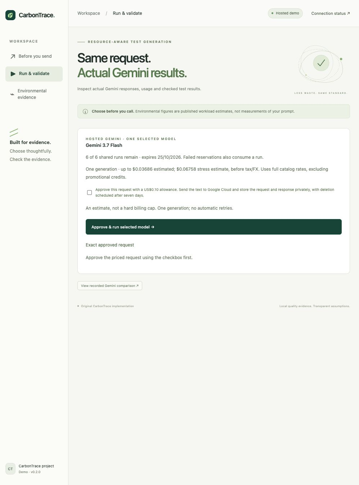

# Validation evidence

## Hosted integration deployment, 18 October 2026

- One approved build succeeded and one new revision deployed. Source snapshot
  334a0557c532 and image digest 3a7c89524132 match the deployment receipt.
- Both approved browser generations completed with raw/effective usage preserved.
  Each used one token count and one generation, with zero metadata reads or retries.
  Flash-Lite: 162 input / 359 output tokens. Flash: 162 input / 384 output tokens.
  Combined conservative catalog estimate USD 0.0040691, not the actual invoice.
- The shared ledger moved from six to four remaining reservations. Receipt reads
  matched the saved evidence. Old local-write/private-record endpoints stay blocked.
- Private bucket IAM, public access prevention, seven-day receipt lifecycle, retained
  budget object, single inference permission, 180-second request timeout and max
  one instance were checked. No generated Python ran on Cloud Run.
- [Deployment receipt](hosted-deployment-result.json),
  [HTTP checks](hosted-http-smoke.json), [real responses](hosted-live-results.json).

## Hosted Gemini integration preparation, 18 October 2026

- 335 Python tests pass; 22 opt-in container checks skipped; coverage 97.50%.
  Strict mypy, Black, Ruff, JavaScript syntax and seven client checks pass.
- Offline fake-provider tests verify both selected models, signed exact approval,
  quote expiry, concurrent six-run limits across ledger instances, replay without
  dispatch, missing-meter failure, provider errors, storage failure before client
  creation, usage reconciliation and private Cloud Storage preconditions.
- Browser verification confirmed the priced hosted quote and unchecked-consent
  block. Its storage and provider adapters were replaced with offline fixtures;
  the screenshot is a local UI preview, not proof of a cloud generation.
- Frozen deployment source: `334a0557c53204a06bd50b3285b5736c8f9c93b15a59fb3da31be6dd59195e9b`;
  52 allowlisted files. Operator and source hashes are checked before credentials.
- Publication scan found no credential-pattern matches in 139 non-ignored files
  or the one reachable Git commit; local data, tools and credentials are excluded.
  Repeat the audit for final deployment receipts before publication.
- No new cloud mutations, model calls or token-count calls were made during this
  preparation. Deployment, two verification generations and the shared public
  allowance await the exact approval in [the deployment plan](hosted-deployment-plan.json).

## Cloud Run deployment

- Build fcd84a01-18c2-481b-aec4-1bcec985b3aa succeeded once; revision carbontrace-demo-00001-mq2
  serves the approved image digest and source snapshot. No rebuild or retry.
- The public HTTPS site passed 13 unauthenticated HTTP checks. Planning, research,
  recorded results and export return 200; quote creation, fixture persistence,
  live execution and local private records return 423.
- Chrome verified custom drafts lose quality matches, explicit model adoption,
  both recorded 4/4 quality gates, published comparison and absence of local
  execution controls. Runtime has no project roles; scaling is 0–1 instances.
- No Gemini or token-count calls were made. Actual invoice was not queried.
  [Receipt](cloud-run-result.json), [checks](cloud-run-smoke.json).

## Cloud Run preparation (before deployment)

- 323 Python tests pass; 22 opt-in container tests skipped; coverage 98.21%.
  Strict mypy, Black, Ruff, JavaScript syntax and seven client checks pass.
- Hosted mode performs no store initialization, permits stateless previews and
  recorded evidence, blocks quote creation, fixture persistence and local records,
  accepts Cloud Run hostnames and cannot switch to local mode on Cloud Run.
- The server uses `0.0.0.0` and the supplied `PORT`. Cloud upload allowlist was
  inspected with the official CLI; credentials/tools/local data are excluded.
- Chrome verified the hosted-mode planner, model adoption and recorded results;
  local execution controls are absent. No build, deployment or inference occurred.
- The Docker image has not yet been built; its first Cloud Build and deployed
  smoke check are subject to the deployment cost approval in `cloud-run.md`.

## Demo workspace cleanup

- Three navigation entries: Before you send, Run & validate, Environmental evidence.
- Shortened visible copy; methods, runner setup and raw provenance are expandable.
- Run API responses no longer disclose the configured filesystem path. A packaged
  read-only real comparison works with an empty local store and preserves the
  original quote/result hash. Export retains the same recorded evidence.
- 315 Python tests pass, 22 opt-in container tests skipped, coverage 98.19%.
  Strict mypy, Black, Ruff, JavaScript syntax and six client tests pass.
- Chrome checked custom draft invalidation, a new single-model quote, all three
  navigation entries and the recorded comparison. No model calls or deployment.

## Pre-call decision and selected-model execution refinement

- 313 Python tests pass with 98.19% statement coverage; 22 opt-in container checks
  remain skipped. Strict mypy, Black, Ruff, JavaScript syntax and six client tests
  pass. No provider calls, token-count calls or generated-code execution occurred.
- Unknown/edited context cannot borrow saved task quality; missing evidence blocks
  a comparative recommendation and failed quality overrides a lower cost/reference.
- Both selected model paths dispatch exactly one metadata read, one count and one
  generation in offline synthetic tests. Payload/context bytes are unchanged and
  correct per-model rates are used. No uncalled-model quality claim is produced.
- The old paired quote still hashes to `317e3391ea97…`; completed results remain
  readable. Quotes are versioned; single-model preparation neither grants execution
  approval nor consumes a run slot.
- Chrome verified the new default, explicit suggestion adoption, removal of the
  suggestion after editing, one-model quote limits and exact downloaded export.
  [Demo guide](precall-decision.md), [decision screenshot](precall-decision-preview.jpg).

## Completed browser-prepared live comparison, 2026-10-17

- The user executed the exact approved plan `317e3391ea97…` manually. Both Gemini
  responses passed the reference and detected all four Clamp faults in the pinned
  rootless runner: Flash-Lite 7 reference tests, Flash 6; no errors or skips.
- Exactly two metadata reads, two token counts and two generations completed.
  Actual input tokens were 161 each; output candidates were 246 and 504. Suite
  hashes, quality provenance, model versions and usage arithmetic were independently
  checked locally without any further provider or generated-code execution.
- Combined recorded-usage catalog cost USD 0.0046848, before credits/tax/FX; billing
  uncertainty is false. Actual request energy/carbon remain unmeasured. One local
  demo slot is consumed and its plan cannot be replayed.
- Chrome verified completed states, actual returned suites, both quality gates,
  separate environmental references and the task-scoped Flash-Lite candidate.
  The completed browser export matches the saved plan/results exactly.
  [Results](live-comparison-results.md), [sanitized report](live-comparison-results.json),
  [verified screenshot](live-comparison-results.jpg).

## Bounded custom live-comparison implementation, 2026-10-17

- 303 Python tests pass with 98.13% statement coverage; 22 opt-in container checks
  remain skipped. Strict mypy, Black, Ruff, JavaScript syntax and six client tests
  pass. New provider/evaluator tests use synthetic doubles with socket connections
  blocked; no fresh model or token-count calls were made for implementation.
- Exact quote hashing, both pre-generation counts, zero-retry stop conditions,
  missing/inconsistent usage, uncertain billing, source/quality provenance, expired
  quotes, one-shot replay rejection and the three-run local limit are covered.
- The browser prepares and reads local plans; only the interactive terminal runner
  can use credentials. The existing web live endpoint remains HTTP 423. Custom
  source is never executed; reviewed examples retain strict isolated quality gates.
- Chrome verified quote preparation, explicit local storage, frozen-run recovery
  and source-edit invalidation, the Before you send shortcut and the actual JSON
  export matching the frozen plan. The older screenshot is retained privately because it displayed a local directory.
- The first Clamp quote was explicitly approved (plan SHA256
  `317e3391ea97c87e11a4192974abf5ee76e33fe687ec08b2d67306bfc9eb686a`).
  Rootless pinned-image and owned-fixture checks passed. Automatic approval review
  rejected terminal confirmation input and cancellation because sandbox approval
  is disabled. No metadata, token-count or generation request was dispatched by
  that blocked attempt; the quote and slots were unconsumed at handoff. The user
  subsequently completed it manually, as recorded above. At handoff the VM was
  confirmed stopped; Podman reported that gvproxy cleanup was not permitted.

## Recorded Gemini workflow, 2026-10-17

- 270 Python tests pass with 97.99% statement coverage; 22 opt-in container checks
  remain skipped. Strict mypy, Black, Ruff, JavaScript syntax checks and six client
  tests pass. No new inference, token-count or generated-code execution occurred.
- The read-only workflow trace is SHA256 checked, tied to the same source report
  as the decision evidence, and validated against exact task/model/prompt pairs.
  Tampering, mismatched reports and missing or duplicate pairs fail closed.
- Chrome verified all three recorded task workflows, matching input-token counts,
  stale-export blocking and both inline checked suites. Code is rendered as text;
  viewing a suite never runs it. [Workflow preview](gemini-workflow-preview.jpg).

The repository excludes local credentials, raw execution ledgers, SQLite history,
virtual environments and runtime caches. Sanitized reports and the six checked
suite text files are included for an offline demonstration. Existing recorded
approvals document completed runs and do not authorize new cloud spending.

## Completed paired task decision, 2026-10-17

- Explicit user approval was recorded against quote hash 7aa444d8bedc. Six fresh
  generations, six token counts and two model metadata reads completed with zero
  retries, no grounding, paid grading or deployment. All six suites passed their
  reference and detected all four seeded faults for each task in the pinned
  rootless runner. No generated code executed on the host.
- Catalog cost totals: Flash-Lite USD 0.0033561; 3.7 Flash USD 0.00674775;
  full comparison USD 0.01010385 before tax/FX/credits, not a verified invoice.
- The immutable ledger, sanitized report, six checked suite text files and source
  hashes are preserved. Fresh evidence now drives both Task decision and exact
  prompt matches in Before you send. The original 3.5/3.8 pilot remains unchanged.
- 253 Python tests pass with 97.88% statement coverage. Strict mypy, Black, Ruff,
  JavaScript syntax and six client tests pass. The 22 broader opt-in container
  regression checks remain skipped; the owned fixture and six actual candidate
  suites were evaluated in the container during this approved batch.
- Downloads require the exact model/task record, serve inert text, verify the
  checked SHA256, and reject a changed file or sibling model. Missing evidence and
  failing candidates still block or change recommendations in synthetic unit tests.
- Chrome verified the completed paired recommendation and both exact-prompt
  pre-send quality cards. The actual browser-downloaded suite matches the evaluated
  SHA256; the JSON export retains the fresh source report and separate CLEER data.
- Lower CLEER facility-energy means support a separate benchmark comparison;
  no actual request or workflow carbon saving is measured. Task quality is limited
  to one saved response per model/function and the owned seeded defects.
- The local VM is confirmed stopped; the web app remains available. Automatic
  approval review rejected closing the leftover Podman terminal session because
  sandbox approval is disabled. No further model calls are authorized.
  [Current decision screenshot](task-decision-preview.jpg).

## Task decision and proposed paired experiment, 2026-10-17

- 242 Python tests pass with 97.87% statement coverage; 22 opt-in container checks
  remain skipped. Strict mypy, Black, Ruff, JavaScript syntax and six client tests
  pass. No new generated code was executed and no provider client was created.
- Task decision uses only the three exact saved Flash-Lite responses, including
  reference/mutant outcomes, observed tokens, original model/suite/image hashes,
  recorded-usage cost, and a hash-bound source report. Gemini 3.7 remains untested;
  a paired recommendation stays pending.
- Synthetic unit-test pairs cover both-pass, one-pass in either direction,
  neither-pass and zero-grid outcomes. A failing low-energy model never wins.
  Errors, skips, empty tests and inconclusive checks do not count as detection.
  Invalid model versions, changed prompts and missing mutant checks are rejected.
- Chrome verified all three tasks, stale-export blocking, zero-grid behavior,
  and the actual downloaded decision export. Both CLEER references remain separate
  from observed task evidence and source/report fingerprints are preserved.
- The immutable six-generation proposal has independent cost/hash checks and
  cannot execute through fabricated approval or an old receipt. The fresh full
  proto3 policy is covered using only a synthetic provider stub; no source reuse.
- Podman runtime state was not verified: its management command requires local
  configuration lock-file write access outside the checkout. The existing image
  remains recorded in sandbox-environment.json. Runtime preflight must succeed
  before any newly approved provider generation.
- No new inference, token-count, paid grading, or deployment calls were made.
  [Verified task decision screenshot](task-decision-preview.jpg).

## Pre-send pair changed to 3.5 Flash-Lite / 3.7 Flash, 2026-10-17

- 211 Python tests pass with 97.74% statement coverage; 22 opt-in container checks
  are skipped. Strict mypy, Black, Ruff, JavaScript syntax and six client tests pass.
- Both current planner models map to exact CLEER records for all six workloads.
  The original 3.8 pilot snapshot is unchanged. No historical 3.8 usage, quality
  response, or token count is attributed to 3.7; the new model has zero saved
  responses and uses rough local input-token scenarios.
- The new comparison snapshot records Google global standard pay-as-you-go
  pricing checked on 2026-10-17, including 3.7 introductory rates through 2026-12-31.
  The original historical pricing and observation snapshot remains unchanged.
- Chrome verified both environmental cards, distinct token/quality evidence,
  current model labels, and exported model identities and source provenance.
- No inference, token-count, paid grading, or deployment calls were made.
  [Verified current model pair](pre-send-37-comparison.jpg).

## CLEER reference in Before you send, 2026-10-17

- 210 Python tests pass with 97.73% statement coverage; 22 opt-in container checks
  remain skipped. Strict mypy, Black, Ruff, JavaScript syntax, and six client tests
  pass. Preflight and research modules have 100% statement coverage.
- New coverage checks all six workloads, unchanged published energy/SD, exact
  Decimal operational-carbon arithmetic, explicit workload choice, missing 3.8
  coverage, zero-grid behavior, source/attribution preservation, and rejected
  sibling/session/provenance overrides. Prompt/token changes do not scale the
  benchmark and existing price and quality calculations remain independent.
- Chrome verified all six workload selections, custom text, grid sensitivity,
  visible source attribution, and an actual exported plan containing research
  evidence without prompt text. Illustration remains off by default.
- No provider, token-count, paid grading, or deployment calls were made.
  [Verified pre-send screenshot](pre-send-cleer-preview.jpg).

## Published CLEER environmental comparison, 2026-10-17

- 195 Python tests pass with 97.72% statement coverage; 22 opt-in container checks
  are skipped. Strict mypy, Black, Ruff, JavaScript syntax checks, and six client
  tests pass. The new research module has 100% statement coverage.
- Tests verify exact sourced means/SDs and total Wh / operational-gCO₂e arithmetic,
  all six workloads, 51 actual models, preserved null SD, unsupported-model nulls,
  bounded inputs, rejection of prompt-based conversions, no persistence/inference,
  and fail-closed source integrity validation.
- Chrome verified all six workloads; stale-export blocking; missing 3.8 Flash
  coverage; unreported SD on an open model; rejection/recovery for equal models;
  and doubled operational carbon at doubled grid intensity with unchanged energy.
- Chrome also verified a lower-energy competitor record without forcing a Gemini
  winner, navigation to the unchanged fixture lab, and a custom prompt with carbon
  explicitly unavailable by default. The downloaded research JSON matches the
  source revision, licence, exact Decimal totals, selected workload, and grid.
- The offline-built wheel contains the new module, CSV, original data licence,
  and browser module, with the expected CSV hash and no cache/helper/secret files.
- Data and source licence are bundled locally; original code is not copied.
  Energy means are published estimates. Carbon is an explicit operational scenario,
  not an attributed request measurement or the source's lifecycle-carbon figure.
- No live model calls, token-count calls, paid grading, or deployment.
  [Verified comparison screenshot](cleer-comparison-preview.jpg).

## Custom requests and automatic local updates, 2026-10-16

- 174 Python tests pass with 97.57% statement coverage; 22 opt-in container
  checks are skipped. Six JavaScript client tests, strict mypy, Black, Ruff,
  and JavaScript syntax checks pass.
- A custom prompt with source code and extra context receives local token/cost
  and illustrative carbon scenarios, with no matching quality evidence and no
  actual-provider carbon claim, execution, persistence, or inference.
- Chrome verified the custom selector, updates after a typing pause, manual mode,
  stale-result/export blocking, automatic application of edited assumptions,
  changed output-token scenarios, and recovery from a blank assumption field
  followed by a prompt edit. The assumption editor remains reachable on errors.
- The reference table records all inputs used for the current impact preview;
  a worked lower-scenario example shows substitutions and units.
- The custom export was downloaded and verified with the latest 1500-token upper
  scenario, 400 gCO₂e/kWh assumption, no matched quality observation, no prompt or
  context text, zero live calls, and actual provider carbon still null.
  [Custom-request screenshot](custom-request-preview.jpg).
- No provider calls, token-count requests, paid grading, or deployment.

## Illustrative pre-send carbon, 2026-10-16

- 173 Python tests pass with 97.57% statement coverage; 22 opt-in container
  checks are skipped. Six JavaScript client tests pass. Strict mypy, Black,
  Ruff, and JavaScript syntax checks pass.
- Scenario tests verify hand-calculated duration, Wh, and gCO₂e; explicit API
  opt-in; null actual-provider carbon; unchanged quality/prices; equal results
  for equal physical assumptions; zero electricity factor without zeroing energy;
  and rejection of invalid ranges, speeds, power, and false measured provenance.
- All 14 development prompts support both selections with illustrative impact.
- Site references to the external project were removed. The retained defensibility
  section states that current figures are assumptions and describes measurement,
  deployment, electricity attribution, uncertainty, and lifecycle requirements.
- Chrome verified all 14 scenario previews, editable grid intensity (doubling it
  doubled gCO₂e while leaving Wh unchanged), disabling/re-enabling the scenario,
  inverted-power rejection, stale-export blocking, and the exported JSON's
  illustrative provenance with actual-provider carbon still null.
  [Verified carbon panel and explanation](carbon-scenario-preview.jpg).
- No live inference, token-count requests, paid grading, or deployment.

## Development example availability and connection recovery, 2026-10-16

- 159 offline Python tests pass; backend statement coverage remains 97.52%.
  The 22 opt-in container checks were skipped for this interface change.
- All 14 development examples pass preflight for both model selections and local
  fixture comparisons. Matching pilot evidence is present only on the three
  actually piloted prompts; carbon remains null for every example.
- Six Node tests cover disconnected and unresponsive servers, successful requests,
  validation errors, unreadable responses, and blocked live execution without retries.
- Strict mypy, Black, Ruff, and JavaScript syntax checks pass.
- Chrome verified automatic selection/loading for all 14 examples. Stopping the
  local server produced an actionable message; restarting it and using Reconnect
  restored the preview while preserving the entered draft.
  The last development exercise also completed its fixture comparison in Chrome.
  [Working development-example screenshot](development-examples-working.jpg).
- No provider calls, token-count calls, cloud resources, or new cloud charges.
  The local app must stay running while the browser uses its HTTP endpoints.

## Earlier pre-send advisor milestone, 2026-10-16

- 145 offline tests pass; backend statement coverage is 97.52%.
- Strict mypy, Black, Ruff, and JavaScript syntax checks pass.
- Chrome verified historical-prompt matching, loss of that match on edits,
  plan-only model selection, stale-export blocking, inverted-range validation,
  and the unchanged fixture comparison flow.
- The JSON export was downloaded and read back: zero live calls, no prompt/context
  text, and carbon marked insufficient evidence with null values.
- No horizontal overflow at a 390-pixel viewport. The saved desktop preview is
  [here](pre-send-preview.jpg). See [feature boundaries](pre-send-advisor.md).
- No live provider calls, token-count API calls, or deployment occurred for this
  feature. The earlier approved six-response pilot is documented separately in
  [pilot-comparison.md](pilot-comparison.md).

## Earlier benchmark/container milestone

The following records the previous fixture-runner milestone; its counts and
zero-provider-call statement apply to that phase, before the approved live pilot.

- 20 reference functions pass all specified literal cases.
- Each of 80 deliberately seeded defects is detected by its thorough fixture.
- All 20 reference/mutant bundles were verified in separate rootless containers
  (five executions per function). This validates infrastructure and owned fixtures;
  no real model response was used.
- The final offline suite passes **93 tests**. The full container suite's **22
  integration checks** passed; after the last cleanup hardening, the reference /
  mutant smoke, timeout/error/empty/weak-suite, and effective-control tests passed
  again (three integration checks).
- Combined backend statement coverage after the final checks: **99.33%**.
- Strict mypy, Black, Ruff, and JavaScript syntax checks pass.
- Chrome inspection verified the new 14th development exercise through comparison:
  the fixture missed one fault, escalated to the thorough fixture, included both
  attempts, and left carbon uncalibrated. The six holdout items are excluded from
  tuning/source-download routes.
- Tests verified disabled networking, read-only source mount, non-root UID,
  no-new-privileges, zero effective capabilities, 256 MiB memory, and 64 processes.
  Runtime failure, empty suites, collection errors, skipped tests, and timeouts
  cannot count as successful fault detection. Output reads are capped at 64 KiB.
- No Google Cloud resources, provider calls, token-count calls, or paid grading
  were used. The live endpoint remains HTTP 423 regardless of flags.
- Temporary preview server and container VM were verified stopped after checks;
  no test containers remain. The prepared local image is retained for reuse.

The container image and base digest are recorded in `sandbox-environment.json`.
The benchmark hash, frozen split, and per-item hashes are recorded in
`benchmark-manifest.json`. The cost fields in both draft run plans remain null;
exact available model IDs, official pricing, authentication, and explicit approval
are required before live inference.

Known limitation: FastAPI's test-client import emits an upstream HTTPX deprecation
warning. All checks pass. Container scoring is not adversarially tamper-proof;
see `sandbox.md`. Benchmark requirements still need independent human review.
